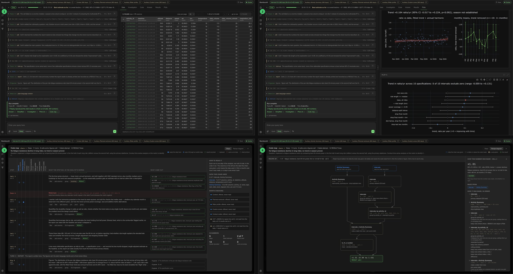
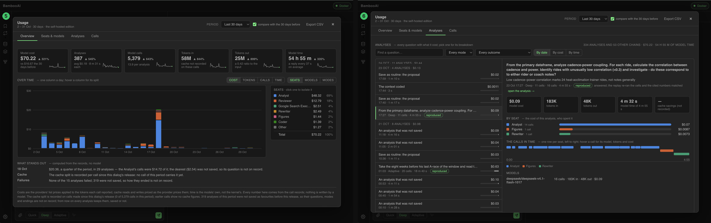

# BambooAI

<a href="https://pypi.org/project/bambooai/"></a> <a href="https://pypi.org/project/bambooai/"></a> <a href="LICENSE"></a>


**Hosted version:** [bambooai.org](https://bambooai.org/)

BambooAI is an AI-powered data analysis workbench designed to make the analytical process transparent, reproducible and open to scrutiny. It gives you visibility into how an AI reaches its conclusions, along with the tools to inspect, challenge and refine its work.

At its core is an LLM Analyst working in a persistent Python environment. Given a dataset and a question, the Analyst explores the data, writes and executes code, examines results and develops its analysis iteratively. You can follow the investigation as it unfolds, ask follow-up questions, revisit earlier steps or branch into a different line of enquiry without losing the previous work.

BambooAI preserves the complete computational record: executed code, outputs, figures, intermediate results, working notes and model interactions. Numerical findings are linked to the code that produced them, while a code map helps trace how results were derived. At the end of an analysis, the supporting computation is replayed in a fresh Python kernel to check reproducibility.

You retain control over the models, the depth of analysis and the direction of the investigation. Adaptive mode introduces a separate Reviewer model that can challenge assumptions, question the evidence and request further tests. Completed analyses can also be turned into reusable routines and applied to new datasets.

The underlying principle is simple: AI-generated analysis should be open to the same scrutiny as any other analytical work. Reproducible calculations are an important part of that, but the choice of methods, assumptions and interpretation must also remain open to examination.



*1 · a run: the turns and cells on the left, the data on the right · 2 · the report's figures · 3 · the chain's code map · 4 · the recipe of one of its numbers.*



*5 · Usage: what a month of analyses cost and where the money and the time went, by day and by seat · 6 · one analysis: its seats, its calls in time, its models.*

## Table of Contents

- [Overview](#overview)
  - [How the analysis works](#how-the-analysis-works)
  - [Inspecting and verifying the work](#inspecting-and-verifying-the-work)
  - [Review and user control](#review-and-user-control)
  - [From exploration to reusable analysis](#from-exploration-to-reusable-analysis)
- [Installation](#installation)
- [Quick Start](#quick-start)
- [Using BambooAI](#using-bambooai)
  - [Runs and actions](#runs-and-actions)
  - [Analysis modes](#analysis-modes)
  - [Reports and verification](#reports-and-verification)
  - [Follow-ups, plots and memory](#follow-ups-plots-and-memory)
  - [Routines](#routines)
- [Configuration](#configuration)
  - [Environment variables](#environment-variables)
  - [Models and seats](#models-and-seats)
  - [Ollama](#ollama)
  - [vLLM](#vllm)
- [Data and integrations](#data-and-integrations)
  - [Documents](#documents)
  - [Intervals.icu context](#intervalsicu-context)
  - [Rider profile](#rider-profile)
  - [Dataset cache and Intervals.icu store](#dataset-cache-and-intervalsicu-store)
- [Where the Code Runs](#where-the-code-runs)
- [Command line](#command-line)
- [Architecture](#architecture)
- [Usage and logs](#usage-and-logs)
- [Development](#development)
- [Contributing](#contributing)
- [Contact](#contact)

## Overview

BambooAI is built around the idea that an AI-generated analysis should be something you can examine, reproduce and build upon. Rather than treating the final report as the only output, it preserves the analytical work that led to it.

### How the analysis works

A primary Analyst model investigates a question through a series of steps, using a persistent Python kernel. It can explore datasets, write and execute code, examine results, consult documents and external sources, and decide what to investigate next. Each step builds on what has already been learned.

The Python environment retains variables, dataframes and intermediate calculations throughout the investigation. Successful code executions are committed to the workspace; failed executions are rolled back to the previous state. Follow-up questions can reuse earlier work, while branching allows alternative approaches to be explored without losing the original analysis.

### Inspecting and verifying the work

BambooAI records the analytical process as it happens. The user can inspect executed code, outputs, figures, intermediate results, working notes and model interactions, including token usage, execution time and cost.

Numerical estimates are recorded alongside the computations that produced them. Reports reference those calculations, and an automatically generated code map helps trace results through the underlying data transformations and intermediate steps.

Once an analysis is complete, BambooAI reconstructs the supporting computation in a fresh Python kernel and runs it again against the original data. This replay verification checks whether the reported numerical results can be reproduced.

Reproducibility is an important safeguard, but it does not establish that a statistical method was appropriate or that a conclusion was justified. BambooAI makes the underlying evidence available so those questions can be examined independently.

### Review and user control

The analytical workflow is configurable. Users can select models, reasoning settings and analysis depth, and intervene as an investigation develops.

In Adaptive mode, a separate Reviewer model examines the available evidence at regular intervals. It can challenge the Analyst's approach, request additional tests, question assumptions or recommend narrowing a conclusion. The Analyst and Reviewer operate under separate instructions and can use different models.

Other specialised roles handle supporting tasks such as document reading, figure generation and report rewriting. These roles can be configured independently.

### From exploration to reusable analysis

An investigation does not have to end with a report. BambooAI can turn completed analyses into reusable routines, preserving the recorded method while allowing selected inputs to change. The original computation can be used to check the routine before applying it to new datasets, without requiring another LLM-driven investigation.

The application supports a range of commercial and open-weight models, including locally hosted models served through Ollama or vLLM. Python execution runs in an isolated container by default, independently of model inference. BambooAI can be deployed locally or used through the hosted service.

BambooAI originated in sports science and physiological data analysis, where repeated measurements, statistical uncertainty and the ability to trace results back to their source are particularly important. Its integrations with Intervals.icu, Endura and SweatStack reflect those origins, but the underlying analytical environment is general-purpose and works with ordinary tabular data, supporting documents and external sources.

## Installation

Requirements: **Python 3.11 or newer**, with **Docker** running (Docker Desktop on macOS and Windows,
Docker Engine on Linux). Docker is where the model-written code runs; see
[Where the Code Runs](#where-the-code-runs) for the alternative.

**Option 1, pip (recommended)**

```bash
pip install bambooai
bambooai serve
```

**Option 2, from the repository**

```bash
git clone https://github.com/pgalko/BambooAI.git && cd BambooAI
python3 -m venv .venv && source .venv/bin/activate
pip install -e .
bambooai serve
```

**Option 3, hosted.** [bambooai.org](https://bambooai.org) runs the same analyst as a service, with
nothing to install.

## Quick Start

1. Run `bambooai serve`. On first use, BambooAI creates `~/bambooai`, generates a `.env` file, builds
   the Docker executor image and opens the app at `http://127.0.0.1:5001`. The initial build can take
   several minutes while it installs the analysis stack, including pandas, NumPy, SciPy, statsmodels,
   scikit-learn, Matplotlib and Plotly.
2. Stop the app with Ctrl+C and add your provider key to `~/bambooai/.env`. An
   [OpenRouter](https://openrouter.ai) key covers the default `cost` preset. The `performance` and `max`
   presets also need an Anthropic key for their Claude seats. Set `GEMINI_API_KEY` to enable web search.
   For local inference, see [Ollama](#ollama) or [vLLM](#vllm).
3. Start `bambooai serve` again, upload a CSV, Parquet, JSON or XLSX file, and ask a question. Choose
   *Quick*, *Deep* or *Adaptive* in the composer.
4. Use **Models & Compute** in the gear menu to select the `cost`, `performance` or `max` model preset.
   **Usage** shows cost, tokens and time by analysis, model and seat.

The working directory holds configuration and saved work:

```text
~/bambooai/
├── .env                              provider keys and settings, read at startup
├── LLM_CONFIG_template.json          model seats, presets, budgets and model properties
├── bambooai.sqlite                   chains, labels, usage, saved preset, encrypted integration credentials
├── config/<user>/LLM_CONFIG.json     generated configuration for the selected preset
├── storage/<user>/threads/           thread records: runs, cells, reports and replay results
├── storage/<user>/usage_ledger.jsonl  completed-analysis records for Usage
├── storage/<user>/favourites/        saved chains
├── storage/<user>/routines/          routine versions, runs and results
├── storage/<user>/context/           codebooks and coded Intervals.icu passages
├── memory/<user>/                    dataset memory pack
└── logs/<user>/                      model calls, tokens, latency and cost
```

Unsaved threads are discarded on the next start; saved chains and usage records persist. Package
upgrades leave this directory intact. To use another directory, set `BAMBOO_HOME` in your shell
environment or pass `--home DIR` to `bambooai serve`. Executor datasets are stored separately in the
persistent Docker volume `bambooai-datasets`, or in the host directory specified by
`BAMBOO_EXECUTOR_DATASETS`.

## Using BambooAI

### Runs and actions

A question starts a **run** consisting of Analyst **turns**. Each turn receives the question, data
description, working notes, prior cells and outputs, and the remaining budget. Large outputs are
abbreviated in the prompt but remain available through `SHOW`.

| Action | Purpose |
|---|---|
| `CELL` | Execute a Python cell in the persistent kernel. |
| `SHOW n` | Reopen a previous cell's full output. |
| `NAMES` | Inspect variables in the kernel. |
| `RECALL` | Consult saved memory for the dataset. |
| `SEARCH` | Search the web with Google AI grounding and return sources. |
| `READ` | Read passages from attached documents or Intervals.icu context using the Reader seat. |
| `ASK` | Request input from the user; the answer continues in the next run. |
| `REPORT` | Finish the investigation and write the report. |

The Analyst follows [`analyst/contract.md`](analyst/contract.md), which asks for estimates and
uncertainty, the conditions under which findings hold, supporting cell references and explicit
limitations. It also asks for appropriate treatment of repeated observations, exclusions and causal
claims. These are instructions to the model, not a guarantee that its methods or conclusions are
correct. Calculations take place in `CELL`; report figures are generated afterward.

### Analysis modes

| Mode | Turns in `performance` | Dollar budget | Review |
|---|---:|---:|---|
| **Quick** | 4 | $0.30 | None |
| **Deep** | 15 | $1.50 | None |
| **Adaptive** | Up to 50 | $4.00 | Every 8 turns |

Turn limits and Adaptive review frequency come from `tier_properties` in `LLM_CONFIG_template.json`. The
dollar budgets are set in the application, **not** in `tier_properties`. The Adaptive depth control can
reduce the turn allowance within the preset's limit.

In Adaptive mode, a separate `Reviewer` examines the work at intervals, including the code and outputs
supporting current results. It can request another test, narrow a claim or recommend reporting. A report
verdict only binds when the cited cells have been checked. The Reviewer also assesses the completed
report against the question. The Analyst and Reviewer can use different models.

### Reports and verification

After `REPORT`, BambooAI performs several distinct steps:

- **Figures.** The `Figures` seat uses objects already in the kernel to create up to three Plotly
  figures, or returns `NONE`. Failed figure code can be retried up to three times; failures are
  disclosed in the report.
- **Report versions and export.** The `Rewriter` produces a second, less technical version alongside the
  Analyst's report. The Answer tab and PDF use the Analyst's report title. The PDF includes the question
  as understood by the Analyst, data source and window, date, mode, replay verdict, figures and
  citations.
- **Numerical checks.** The technical report's numbers are checked against recorded computational
  evidence; the rewritten report is checked against the technical one. Unmatched values are flagged, not
  silently corrected.
- **Reproduction.** Committed cells are replayed in order in a fresh kernel, through the last cited or
  figure-producing cell. Numerical outputs are compared with the original run. The closing card shows
  the verdict and number of values checked; replayed figures appear in **Plots**.
- **Code map.** Built from committed code and kernel records, without an LLM. It traces each result to
  its cells, input data, intermediate values and choices such as seeds or thresholds. Open it from the
  closing card or a report's `[cell n]` citation. It documents *how* a result was obtained, not whether
  the method was sound. See [`docs/CODEMAP_DESIGN.md`](docs/CODEMAP_DESIGN.md).
- **Reach report.** Records activity outside the supplied data: network hosts and transfer sizes, files,
  environment-variable names and spawned programs, with the responsible cells. It also marks refused
  cells and whether a resource was named in the question. Most activity is observed and reported;
  restricted-module use and access to cloud instance metadata can be refused. See
  [`docs/REACH_DESIGN.md`](docs/REACH_DESIGN.md).

These checks catch reproducibility and reporting problems; reproducing a calculation does not validate
its statistical design or interpretation.

### Follow-ups, plots and memory

A follow-up continues from the preceding run's Python state; a new question starts a fresh workspace.
Runs form navigable chains. If the dataset changes, BambooAI starts a fresh kernel and keeps earlier
chains as context, marked as using other data. Replay and routines then use only calculations made on
the current dataset. Data continuity is determined from file and dataset metadata, not a byte-for-byte
file comparison.

Use the chat button on a figure to ask about it. The image is included only when the Analyst supports
images and its `model_properties` entry sets `"multimodal": "true"`; otherwise the question is sent
without the image, and the app indicates that limitation.

Saving a run invokes the `Knowledge Distiller` to capture dataset-specific notes, column quirks and
useful approaches in `memory/<user>/memory_pack.yaml`. Future analyses of the same data can retrieve
them using `RECALL`.

### Routines

**Save as routine** turns a completed chain into a reusable Python method. The `Promoter` identifies up
to five adjustable inputs, such as dates or thresholds, without turning dataset identifiers into
parameters. Data-dependent values are expected to be computed from the data rather than hardcoded. See
[`docs/ROUTINES_DESIGN.md`](docs/ROUTINES_DESIGN.md).

The routine is saved with a verification state. When the original data is available, *run zero*
re-executes the method and compares its recorded `RESULT` lines. A version still verifying, or one
that fails verification, cannot run. If the original data is unavailable, the version is marked
**unverified** and can run without a verified run zero. A chain that used no dataset, such as a
simulation, is verified the same way and its routine runs without data: the inputs are the values
the code starts from, such as starting conditions, parameters or a seed. The routine keeps the
chain's code as written, with the adjustable inputs in place. A model-free check then tries a
shorter run of only the statements the tracked results and figures depend on, and keeps it for later
runs when it reproduces the same results and figures. For Intervals.icu data, the method is also
tried on a day, a week and a month of the original data, so you can see what a shorter interval will
return before running one.

The routine script runs without an LLM. Select an Intervals.icu athlete and a date window or calendar
interval (day, week, month or year), or a file from the Dataset cache, supply the inputs and run the
script. BambooAI checks the expected columns, auxiliary files and input values before execution. The
script runs one statement at a time: a step that cannot be computed on the new data costs only the
results that depend on it, which are left blank with the reason, and a window with no data is recorded
as an empty run. BambooAI records results, figures and differences from the previous run for the same
athlete (or from run zero). Differences are classified against the previous result interval (outside,
within, or not computed). The first run has no comparison; differences are never calculated across
athletes. Upload-based runs without an athlete form a single comparison group. In the Summary,
**All athletes** shows each athlete's results for the same week, month or dates side by side, and
offers the run for an athlete who has none. Cached data is reused when it covers the requested window.

## Configuration

### Environment variables

Set variables in `~/bambooai/.env`. Use full-line `#` comments; comments appended to values are not
supported.

| Variable | Purpose |
|---|---|
| `OPENROUTER_API_KEY`, `OPENAI_API_KEY`, `ANTHROPIC_API_KEY`, `GROQ_API_KEY`, `XAI_API_KEY`, `MISTRAL_API_KEY`, `DEEPSEEK_API_KEY`, `GEMINI_API_KEY` | Keys for the providers used by your seats; `GEMINI_API_KEY` also enables grounded web search (`SEARCH`). |
| `BAMBOO_LEVEL` | Initial model preset: `cost` (default), `performance` or `max`, until one is saved in the app. |
| `BAMBOO_COMPUTE` | `docker` (default) or `local`. |
| `EXECUTOR_PORT` | Published executor port (default `5055`). |
| `BAMBOO_EXECUTOR_DATASETS` | Host directory for executor data, instead of the `bambooai-datasets` Docker volume. |
| `EXECUTION_MODE`, `EXECUTOR_API_BASE_URL` | Use your own executor with `EXECUTION_MODE=api` and its URL. This overrides `BAMBOO_COMPUTE`. |
| `REMOTE_OLLAMA`, `REMOTE_VLLM` | Local model server base URLs, for example `http://localhost:11434`. |
| `BAMBOO_USER` | Identity for per-user paths (default `local`). |
| `SWEATSTACK_CLIENT_ID`, `SWEATSTACK_CLIENT_SECRET` | SweatStack app registration; the integration is unavailable without these. |
| `APP_PORT` | Web app port (default `5001`). |
| `SESSION_COOKIE_NAME`, `FLASK_SECRET`, `LLM_CONFIG_ENCRYPTION_KEY` | Server settings; the last two secrets are generated on first use. |

### Models and seats

A **seat** is a model role such as `Analyst`, `Reviewer` or `Reader`. Each seat has its own model,
provider, reasoning effort and token limit. The working-folder `LLM_CONFIG_template.json` defines four
seat groups, `free_agent_configs`, `cost_agent_configs`, `performance_agent_configs` and
`max_agent_configs`, plus `tier_properties` and `model_properties`.

The shipped `performance` configuration illustrates the structure (the keys and values below are kept as
defined in the template):

```json
"performance_agent_configs": [
  {"agent": "Analyst",                   "details": {"model": "claude-sonnet-5-5",                  "provider": "anthropic",   "reasoning_effort": "xhigh",  "max_tokens": 32000, "temperature": 0}},
  {"agent": "Figures",                   "details": {"model": "claude-sonnet-5-5",                  "provider": "anthropic",   "reasoning_effort": "low",    "max_tokens": 16000, "temperature": 0}},
  {"agent": "Rewriter",                  "details": {"model": "claude-sonnet-5-5",                  "provider": "anthropic",   "reasoning_effort": "low",    "max_tokens": 16000, "temperature": 0}},
  {"agent": "Reader",                    "details": {"model": "deepseek/deepseek-v4.1-flash-1017",  "provider": "openrouter",  "reasoning_effort": "low",    "max_tokens": 16000, "temperature": 0}},
  {"agent": "Coder",                     "details": {"model": "deepseek/deepseek-v4.1-flash-1017",  "provider": "openrouter",  "reasoning_effort": "none",   "max_tokens": 16000, "temperature": 0}},
  {"agent": "Reviewer",                  "details": {"model": "openai/gpt-6.1-sol",                 "provider": "openrouter",  "reasoning_effort": "high",   "max_tokens": 48000, "temperature": 0}},
  {"agent": "Promoter",                  "details": {"model": "claude-sonnet-5-5",                  "provider": "anthropic",   "reasoning_effort": "medium", "max_tokens": 32000, "temperature": 0}},
  {"agent": "Knowledge Distiller",       "details": {"model": "deepseek/deepseek-v4.1-flash-1017",  "provider": "openrouter",  "reasoning_effort": "none",   "max_tokens": 24000, "temperature": 0}},
  {"agent": "Google Search Executor",    "details": {"model": "gemini-flash-latest",                "provider": "gemini",      "reasoning_effort": "none",   "max_tokens":  8000, "temperature": 0}},
  {"agent": "Google Search Summarizer",  "details": {"model": "deepseek/deepseek-v4.1-flash-1017",  "provider": "openrouter",  "reasoning_effort": "none",   "max_tokens": 12000, "temperature": 0}},
  {"agent": "Image Generator",           "details": {"model": "deepseek/deepseek-v4.1-flash-1017",  "provider": "openrouter",  "reasoning_effort": "none",   "max_tokens": 28000, "temperature": 0}}
],
"tier_properties": {
  "performance": {"analyst_turns_quick": 4, "analyst_turns_deep": 15, "analyst_turns_adaptive": 50, "analyst_review_every": 8}
},
"model_properties": {
  "claude-sonnet-5-5": {"capability": "reasoning", "multimodal": "true", "templ_formating": "xml",
                        "prompt_tokens": 0.002, "completion_tokens": 0.01, "cache_read_tokens": 0.0001, "cache_write_tokens": 0.0025,
                        "reasoning_style": "effort", "reasoning_efforts": ["low", "medium", "high", "xhigh", "max"],
                        "thinking_off": "between_tools", "no_sampling": true}
}
```

The default `cost` preset uses OpenRouter throughout (DeepSeek with Grok for review); `performance` uses
Claude for several seats, and `max` moves those to Opus. Supported providers include OpenRouter, OpenAI,
Anthropic, Google, Groq, Mistral, xAI, DeepSeek, Ollama and vLLM.

| Seat | Function |
|---|---|
| `Analyst` | Investigation, code execution and technical report. |
| `Reviewer` | Periodic and final review in Adaptive mode. |
| `Figures` | Plotly figures after the report; falls back to `Analyst` if absent. |
| `Rewriter` | Second report version. |
| `Reader` | Targeted document and context reads (`READ`). |
| `Coder` | Codes Intervals.icu context against the codebook; falls back to `Reader`. |
| `Promoter` | Extracts routine inputs; falls back to `Analyst`. |
| `Knowledge Distiller` | Dataset memory on save. |
| `Google Search Executor` | Grounded Gemini search. |
| `Google Search Summarizer` | Search digest with citations. |
| `Image Generator` | SVG infographic for thread synthesis, not every analysis report. |

Seat fields are `model`, `provider`, `reasoning_effort`, `max_tokens` and `temperature`. The effort
names (`none`, `low`, `medium`, `high`, `xhigh`, or model-specific levels) are mapped to each provider's
interface. Every configured model must appear in `model_properties`, including pricing per 1,000 tokens
(cached tokens have separate rates), formatting (`xml` or `text`) and reasoning metadata. The template
uses the key `templ_formating` as written. Set `multimodal` to `"true"` for image-capable Analyst models
when using *Ask about a plot*.

For short code or JSON replies, a lower reasoning effort may leave more of `max_tokens` available for
the actual answer. In particular, keep `Figures` at a low effort and give `Promoter` enough output
tokens. BambooAI generates `config/<user>/LLM_CONFIG.json` for the chosen preset and rebuilds it when
the template is newer.

### Ollama

Set a seat's provider to `ollama` in `LLM_CONFIG_template.json` and add the model to `model_properties`.
For example, an Analyst using `gpt-oss:20b`:

```json
{
  "agent": "Analyst",
  "details": {
    "model": "gpt-oss:20b",
    "provider": "ollama",
    "reasoning_effort": "high",
    "max_tokens": 16000,
    "temperature": 0
  }
}
```

```json
"gpt-oss:20b": {
  "capability": "reasoning",
  "templ_formating": "text",
  "prompt_tokens": 0.0,
  "completion_tokens": 0.0,
  "context_window": 65536,
  "reasoning_efforts": ["low", "medium", "high"]
}
```

- **Context:** `context_window` controls Ollama's `num_ctx`. Use at least 32,768 tokens for the Analyst
  (65,536 in this example). Without it, Ollama's default may be much smaller and long prompts can be
  truncated; BambooAI warns when detected. Ollama cloud manages context separately.
- **Reasoning:** `reasoning_efforts` lists the supported levels; `reasoning_effort` selects one. Check
  them with `ollama show <model>`. Models with only an on/off thinking switch use that instead; `none`
  disables thinking where supported.
- **Repetition penalty:** BambooAI sends `repeat_penalty: 1.0` to avoid Ollama's default penalty
  affecting code or structured output. Override it in `model_properties` if needed.
- **Cost:** Use `0.0` for local-model token prices. Ollama cloud use is governed by your Ollama account
  and plan.

Ollama defaults to `http://localhost:11434`. For a server on another machine:

```dotenv
REMOTE_OLLAMA=http://<server-address>:11434
```

Pull models on the server itself; for Ollama cloud models served through it, run `ollama signin` there.
To listen beyond the loopback interface, use `OLLAMA_HOST=0.0.0.0` and restrict the network to trusted
clients. All seats using `ollama` share this connection.

To use Ollama cloud without running a local server:

```dotenv
REMOTE_OLLAMA=https://ollama.com
OLLAMA_API_KEY=your_api_key
```

### vLLM

BambooAI connects to vLLM through its OpenAI-compatible API. The following is the tested setup for
Qwen3.8-27B, 8-bit quantisation, a 64k context and a single RTX A6000 (48 GB), using vLLM 0.30:

```bash
vllm serve ~/models/Qwen3.8-27B \
  --quantization fp8 --linear-backend marlin \
  --language-model-only \
  --compilation-config '{"mode": 0, "cudagraph_mode": "FULL"}' \
  --speculative-config '{"method": "mtp", "num_speculative_tokens": 2}' \
  --max-model-len 65536 --max-num-seqs 8 \
  --reasoning-parser qwen3 \
  --served-model-name qwen3.8-27b \
  --host 0.0.0.0 --port 8000
```

`--served-model-name` is the name used in BambooAI's configuration. `--reasoning-parser` returns
thinking separately from the answer. The example uses Marlin kernels for an Ampere GPU, disables vision
components with `--language-model-only`, uses CUDA graphs without `torch.compile`, and enables the
model's multi-token-prediction head. Remove the speculative configuration for models without that head;
adapt GPU-specific flags to your hardware.

Configure the seat and matching model properties:

```json
{
  "agent": "Analyst",
  "details": {
    "model": "qwen3.8-27b",
    "provider": "vllm",
    "reasoning_effort": "high",
    "max_tokens": 16000,
    "temperature": 0
  }
}
```

```json
"qwen3.8-27b": {
  "capability": "reasoning",
  "templ_formating": "text",
  "prompt_tokens": 0.0,
  "completion_tokens": 0.0,
  "context_window": 65536,
  "reasoning_efforts": ["low", "medium", "xhigh"]
}
```

Set `context_window` to match the server's `--max-model-len`. Unlike Ollama, vLLM refuses requests that
exceed the configured context; BambooAI can warn before sending them. With `--reasoning-parser`, effort
levels come from `reasoning_efforts` (Qwen3.8 uses `low`, `medium`, `xhigh`); unsupported choices are
mapped to a supported level, and `none` disables thinking. Use `0.0` token prices for a self-hosted
server.

Set its address in `.env`:

```dotenv
REMOTE_VLLM=http://<server-address>:8000/v1
```

If vLLM uses `--api-key`, also set `VLLM_API_KEY` in `.env`. With every seat on a locally hosted model,
LLM requests stay on your network; Ollama cloud, `SEARCH` and external data integrations still contact
their respective services. Running Python in Docker does not, by itself, keep model requests local.

## Data and integrations

- **Files:** CSV, Parquet, JSON or XLSX as the primary dataset, available as `df` in the kernel and
  browsable in **Data**. Additional uploaded files are available to cells by path.
- **Intervals.icu and Endura:** Add API keys in the app; credentials are encrypted in the working-folder
  database. Intervals.icu supports a separate key per athlete. **Settings → Intervals ICU** lists
  athletes linked to keys; the load dialog shows their cached data and proposes the next window from the
  last held day. Choose a date range to load activities, summary, intervals and wellness data, with
  optional context and profile files.
- **SweatStack:** OAuth integration, requiring `SWEATSTACK_CLIENT_ID` and `SWEATSTACK_CLIENT_SECRET`
  from your own app registration.
- **Web search:** Set `GEMINI_API_KEY` to make `SEARCH` available with grounded sources.

### Documents

Attach up to **four documents per thread**, each up to **10 MB**, using the paperclip's **Document**
option. Supported formats are PDF, `.docx`, Markdown and text. Documents are parsed into numbered
passages (`D1.17` means passage 17 of document 1), with page or heading locators. Tables are exposed as
dataframes.

The **Documents** pill opens the document map and passages. The Analyst initially sees the outline,
tables and figure captions, not the full text. Inside the kernel, a document is exposed through
`D1.text`, `D1.page(n)`, `D1.grep(pattern, context=1)`, `D1.units(a, b)`, `D1.table(n)` and
`D1.outline()`.

The Analyst can also issue `READ` to ask the `Reader` seat about selected passages (up to
**three reads per run**). Quotations are checked against the parsed text, and reports can cite `[D1.17]`
alongside `[cell n]`. Citations preview the passage and link to it in Documents.

Files live at `storage/<user>/documents/<thread>/` and are deleted with their thread. Parsing uses
`pdfplumber` and `python-docx`. Scanned PDFs without a text layer are unsupported (no OCR), as is parsed
text over **2 MB**. Older seat templates without `Reader` still work, but `READ` requires adding that
seat.

### Intervals.icu context

With **Context** enabled in an Intervals.icu load (the default), BambooAI includes activity messages,
notes, calendar entries and planned workouts alongside the numerical data. Passages retain their date,
type, author's role and original text. The `Coder` reads them against a user-managed codebook and adds
labels, with English renderings of non-English passages kept beside the originals. Coded passages are
cached per athlete.

In the kernel, `CTX.frame()` returns passages and `CTX.codes()` their classifications. Use
`CTX.grep(pattern)`, `CTX.around(date, days=3)`, `CTX.between(a, b)`, `CTX.on(activity_id)` and
`CTX.text(ref)` to inspect context; search methods also accept `as_frame=True`. `READ CTX what` asks the
`Reader` to find relevant passages. The Analyst first receives a summary of passage counts, types,
languages and codes, not their full text. Reports quote passages under citations such as `[C.417]`,
identifying translated text as rendered. Code counts reflect model classifications, not verified facts.

A separate planned-workout dataset links prescriptions and targets with completed activities, including
compliance, duration, load, steps and structure. If no codebook entry fits a passage, the `Coder` can
assign a provisional code for review. The codebook UI lets you accept, rename, merge or reject
proposals, and import or export JSON. Changes affect subsequent loads; existing passages are not
automatically re-coded. See [`docs/CONTEXT_DESIGN.md`](docs/CONTEXT_DESIGN.md).

### Rider profile

**Rider profile** is enabled by default for Intervals.icu loads. It writes the athlete's settings
alongside the dataset: weight, height, resting HR and age, per-sport FTP and thresholds, zone
boundaries, power-duration estimates, custom zone definitions and custom-field metadata (types, units
and options). When present, a separate file contains time in custom zones per activity. Summary,
interval and wellness files retain custom fields, including option labels and their numeric values.

The profile excludes names, email and credentials. It records that 1 is the favourable end of each
wellness 1–4 scale and makes thresholds available in the Analyst's data description; the summary also
includes settings in force on each day. See
[`docs/RIDER_PROFILE_DESIGN.md`](docs/RIDER_PROFILE_DESIGN.md).

### Dataset cache and Intervals.icu store

The executor retains loaded frames, integration files and datasets written with `DS.save`. The
**Dataset cache** in the side rail groups them by source and athlete, with each dataset's span, contents
and size. Selecting an entry shows its files, columns and available actions:

| Action | Effect |
|---|---|
| **Load dataset** | Put the chosen window (*From → To*, or the *3 m · 6 m · 1 y* picks) on the Data tab. Days already in the cache are reused; missing days are fetched from Intervals.icu, which requires that athlete's API key. |
| **Clear dataset** | Remove it from the cache and the Data tab after confirmation. |
| **×** on a Data pill | Remove the dataset from the Data tab without deleting its cached copy. |

On an athlete's line, **Load all datasets** and **Clear the cache** do the same for everything held. The
Data tab shows one athlete at a time. Switching athletes clears the prior athlete's loaded pills
after confirmation and starts a fresh kernel; the earlier thread history remains. Loading Activities
brings its associated datasets into the same window. Routines reuse a cached load when it already covers
their requested window.

Under the cache, an incremental Intervals.icu store retains parsed activities, messages, laps, wellness
and calendar records, plus profile snapshots. A load retrieves the requested window's activity list,
fetches missing or changed details, and reuses older parsed data. Messages and laps from activities in
the last **60 days** are refreshed; wellness and calendar entries are merged. **Everything again**
forces a fresh fetch of the window.

Load limits are based on the **compute tier**, not the model preset:

| Compute tier | Maximum window per load | How far back you can load |
|---|---|---|
| Free | 3 months | 1 year |
| Plus | 6 months | 2 years |
| Pro / local edition | 1 year | 4 years |

Stored activities older than the tier's reach are pruned unless used by a load in the last **30 days**;
generated window files expire after a month. All executor data survives container and image upgrades in
`bambooai-datasets`. Set `BAMBOO_EXECUTOR_DATASETS` to use a host folder instead. To reset the
Docker-backed cache, remove the volume with `docker volume rm bambooai-datasets` after stopping its
consumers. See [`docs/DATASETS_DESIGN.md`](docs/DATASETS_DESIGN.md) and
[`docs/INCREMENTAL_LOADS_DESIGN.md`](docs/INCREMENTAL_LOADS_DESIGN.md).

## Where the Code Runs

By default, analysis cells, replay and integration data fetching run in the Docker **executor**
(`containers/executor/`), a Flask API with a persistent Python kernel. `bambooai serve` builds an image
tagged `bambooai-executor:<package-version>-<executor-build>` when needed, starts it on `127.0.0.1:5055`
with `/app/datasets` backed by the persistent volume, and stops it when the web app exits.
`--keep-executor` leaves it running; the app's **Restart** control restarts it.

Alternatives:

- **Local subprocess:** `bambooai serve --compute local` or `BAMBOO_COMPUTE=local`. No Docker required,
  but there is no container isolation and executor-hosted integrations are unavailable.
- **Your own executor:** Configure `EXECUTION_MODE=api` and `EXECUTOR_API_BASE_URL` in `.env`. Find the
  image built for your installed package with `docker images bambooai-executor` and substitute its tag
  for `IMAGE_TAG`:

```bash
docker run -p 5055:5000 -v bambooai-datasets:/app/datasets IMAGE_TAG
```

Restrict access to trusted hosts. The web server binds to `127.0.0.1` by default;
`bambooai serve --host 0.0.0.0` exposes it on all interfaces. Provider keys are read from `.env` at
startup rather than entered in the app; integration credentials are managed in the app. When using
remote models, requests may include dataset descriptions, code and outputs. Local execution is not the
same as local inference.

## Command line

```
bambooai serve [--home DIR] [--port N] [--host H] [--compute docker|local] [--keep-executor] [--no-browser]
bambooai init  [--home DIR]      create the working folder and its files without starting
bambooai where                   print the working folder
```

## Architecture

```
browser ── HTTP / SSE ── web_app (Flask) ── HTTP ── executor container (Flask API + persistent kernel)
                            │
                            ├── analyst/     the turn loop (session.py), the contract, the notebook,
                            │                the report, the reproduction run, routines, the context
                            ├── bambooai/    model adapters (models/), log manager, config builder,
                            │                the local store (db/local_store.py, SQLite), the hosts
                            │                of routines and of the context's coding pass
                            ├── delve/       the persistent kernel: a subprocess with a checkpoint per
                            │                committed cell and rollback of a failed one
                            └── containers/executor/   the executor image
```

- [`analyst/session.py`](analyst/session.py) drives the turn loop using
  [`analyst/contract.md`](analyst/contract.md). Reports, replay, the code map and routines are
  implemented under `analyst/`.
- [`delve/kernel.py`](delve/kernel.py) runs code in a checkpointed subprocess; successful cells persist
  and failed cells roll back.
- [`bambooai/models/`](bambooai/models/) provides model adapters, reasoning-effort mapping and prompt
  caching. `bambooai/db/local_store.py` uses SQLite behind the same interface as the hosted Supabase
  store.
- `analyst/context.py`, `analyst/coder.py` and `containers/executor/intervals_store.py` implement
  training context, coding and incremental data storage.
- `tools/stack/` provides an offline test stack with scripted model responses and fake
  Intervals.icu/Endura services.

## Usage and logs

- `logs/<user>/bambooai_run_log.json`: model calls for the current thread, with seat, prompt, response,
  tokens, time and cost. Replaced when a new thread starts.
- `logs/<user>/consolidated_logs.json`: accumulated calls across threads, rotated at 5 MB.

The **Usage** dialog (gear menu) filters by the last 24 hours, 7, 30 or 90 days, or the current or
previous month. It compares cost, tokens, calls, time and analyses with the preceding period; breaks
metrics down by seat, model, mode or day; and offers per-analysis call timelines, raw records and CSV
export. Prompt-cache savings use recorded token accounting. The closing card opens a run's per-call
telemetry; each turn also exposes the exact prompt used. These figures come from logs, not
model-generated estimates.

## Development

```bash
git clone https://github.com/pgalko/BambooAI.git && cd BambooAI
python3 -m venv .venv && source .venv/bin/activate
pip install -e ".[dev]" && python -m playwright install chromium

./run_battery.sh                                                  # unit suites: analyst, kernel, notebook, report, replay
python tests/e2e/test_stack.py --edition local --compute local    # the real app, page and kernel; a scripted model, no network
python tests/e2e/test_stack.py --edition local --compute direct   # the same against an executor process
python tests/e2e/test_integrations.py                             # the loaders against the fake Intervals.icu and Endura; a routine run on the next window and the next race
python tests/e2e/test_local_store.py                              # the store survives a server restart
python tests/e2e/test_date_inputs.py                              # Chromium over the loaders' date inputs
python tests/e2e/test_pill_strip.py                               # Chromium over the top bar's chip row
python tests/e2e/test_package.py                                  # the wheel in a fresh virtualenv; serve with a docker stand-in
python tools/render_gallery.py --out /tmp/gallery                 # every page state, both themes, for visual comparison
```

CI (`.github/workflows/ci.yml`) runs the test battery and builds the executor image on each push. The
browser suites and packaging test are run locally. Tags matching `v*` publish to PyPI through
`.github/workflows/release.yml`.

Further design and maintenance notes: [`docs/DESIGN_CHECKLIST.md`](docs/DESIGN_CHECKLIST.md),
[`docs/OSS_DESIGN.md`](docs/OSS_DESIGN.md), [`docs/ROUTINES_DESIGN.md`](docs/ROUTINES_DESIGN.md),
[`docs/CONTEXT_DESIGN.md`](docs/CONTEXT_DESIGN.md),
[`docs/INCREMENTAL_LOADS_DESIGN.md`](docs/INCREMENTAL_LOADS_DESIGN.md),
[`docs/CODEMAP_DESIGN.md`](docs/CODEMAP_DESIGN.md), [`docs/REACH_DESIGN.md`](docs/REACH_DESIGN.md),
[`docs/DATASETS_DESIGN.md`](docs/DATASETS_DESIGN.md), [`docs/USAGE_DESIGN.md`](docs/USAGE_DESIGN.md) and
[`HANDOVER.md`](HANDOVER.md).

## Contributing

Issues and pull requests are welcome. Keep changes small and readable, run the battery and the
end-to-end story before opening a pull request, and state what you tested.

## Contact

palo@bambooai.io · [Issues](https://github.com/pgalko/BambooAI/issues) ·
[Discussions](https://github.com/pgalko/BambooAI/discussions)

---

<sub>BambooAI 1.x was a Python library used from notebooks (<code>from bambooai import BambooAI</code>). Version 2 replaces it.
The 1.x releases remain installable with <code>pip install "bambooai&lt;2"</code>; the source is on the
<a href="https://github.com/pgalko/BambooAI/tree/v1">v1 branch</a>.</sub>
