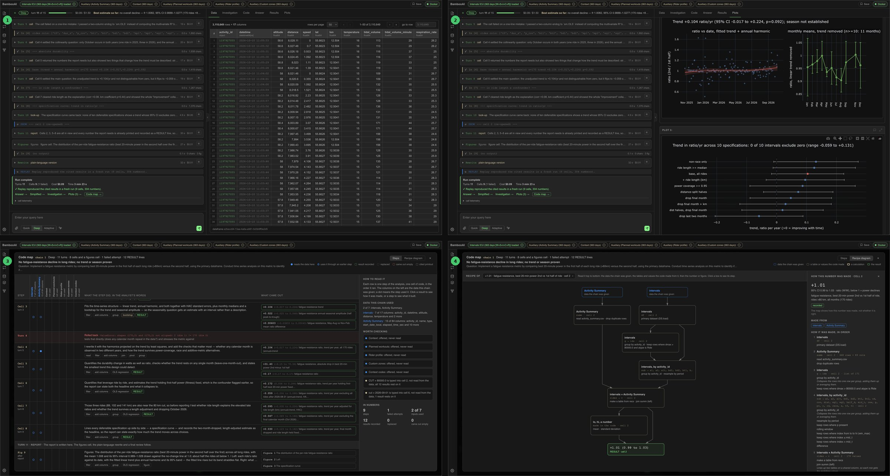

# BambooAI

<a href="https://pypi.org/project/bambooai/"></a> <a href="https://pypi.org/project/bambooai/"></a> <a href="LICENSE"></a>


**Hosted version:** [bambooai.org](https://bambooai.org)

BambooAI is an LLM-driven data analysis environment built around a persistent Python kernel, an explicit analysis protocol, and a fully inspectable computational record.

A primary Analyst model works through a question iteratively. Each turn has one action: run a Python cell, inspect earlier output, search or read supporting material, ask for clarification, or write the report. Executed cells remain in a persistent workspace, so later steps and follow-up questions can build directly on earlier computation.

The aim is to keep the analytical process visible rather than hiding it behind a final answer. The code that ran, its outputs, figures, intermediate results, working notes and model calls remain available for inspection. Numerical results reported by the Analyst are tied to the cells that produced them, making it possible to trace a conclusion back through the computation that supports it.

At the end of a run, the relevant analysis is assembled and executed again against the original data in a fresh kernel. The replay checks whether the numerical results cited by the report can be reproduced from the recorded computation.

Adaptive runs can additionally use a separate Reviewer model, with its own instructions, to inspect the evidence during the analysis and challenge the method, request another test, narrow a conclusion or end the investigation.



*1 · a run: the turns and cells on the left, the data on the right · 2 · the report's figures · 3 · the chain's code map · 4 · the recipe of one of its numbers.*

## Table of Contents

* [Overview](#overview)
* [Installation](#installation)
* [Quick Start](#quick-start)
* [Features](#features)
* [How It Works](#how-it-works)

  * [Reports and checks](#reports-and-checks)
  * [Modes and budgets](#modes-and-budgets)
  * [Follow-up questions](#follow-up-questions)
  * [Ask about a plot](#ask-about-a-plot)
  * [Memory](#memory)
  * [Routines](#routines)
* [Configuration](#configuration)

  * [Environment Variables](#environment-variables)
  * [Models and Seats](#models-and-seats)
  * [Ollama](#ollama)
  * [vLLM](#vllm)
* [Data and Integrations](#data-and-integrations)

  * [Documents](#documents)
  * [The words beside the numbers](#the-words-beside-the-numbers)
  * [The settings the data is read against](#the-settings-the-data-is-read-against)
  * [The Dataset cache and the store](#the-dataset-cache-and-the-store)
* [Where the Code Runs](#where-the-code-runs)
* [Command Line](#command-line)
* [Architecture](#architecture)
* [Logging and Usage](#logging-and-usage)
* [Development](#development)
* [Contributing](#contributing)
* [Contact](#contact)

## Overview

BambooAI separates the analytical process into an LLM-controlled workflow and an executable computational record. The design is intended to make an AI analysis transparent and interpretable: not only what conclusion was reached, but what was computed, what evidence supports it, and how the analysis developed along the way.

* **Iterative analysis.** One primary Analyst works through the problem turn by turn in a persistent Python workspace. Each computation can inform the next decision rather than requiring the model to plan and generate the entire analysis in one response.

* **Transactional execution.** The kernel keeps a checkpoint after every committed cell. If a cell fails, the attempted changes are discarded and the previous namespace is restored.

* **Evidence-linked results.** Numerical estimates are recorded when they are computed and remain associated with the cells that produced them. The report cites those cells rather than treating generated prose as the source of the result.

* **Full visibility.** Executed code, outputs, figures, intermediate results, working notes, prompts, model usage, timing and cost remain available through the application. A reported result can therefore be followed back through the analysis that produced it.

* **Reproduction.** Before completion, the successful computation through the report's supporting cells is rerun against the original data in a fresh kernel. The resulting output is compared with the numerical evidence from the original run. A successful replay establishes computational reproducibility, not that the chosen method or interpretation is necessarily correct.

* **Independent review.** Adaptive mode introduces a separate Reviewer role with its own prompt and model configuration. It receives the current evidence at defined intervals and can require another test, narrow the supported conclusion, or determine that the analysis is ready to report.

* **Model-independent orchestration.** Analyst, Reviewer, Figures, Rewriter, Reader and the other workflow roles can use different models and reasoning settings. BambooAI supports OpenRouter, OpenAI, Anthropic, Google, Groq, Mistral, xAI and DeepSeek, as well as locally served open-weight models through Ollama and vLLM.

* **Isolated execution.** Model-generated Python runs in a dedicated executor container by default. Model inference is configured separately and can use either remote providers or models hosted on the local network.

BambooAI originated in sports-science and physiological data analysis, where repeated observations, uncertainty, confounding and the provenance of reported results matter. Intervals.icu, Endura and SweatStack integrations grew from that use case, but the analysis workflow itself is general and works with ordinary tabular datasets, supporting documents and external sources.

Completed analyses can also be saved as routines. A routine extracts the small set of inputs that may change, verifies the original run, and can then execute the same recorded method against new data without another LLM analysis.

## Installation

Requirements: **Python 3.11 or newer**, with **Docker** running (Docker Desktop on macOS and Windows,
Docker Engine on Linux). Docker is where the model-written code runs; see
[Where the Code Runs](#where-the-code-runs) for the alternative.

**Option 1, pip (recommended)**

```bash
pip install bambooai
bambooai serve
```

**Option 2, from the repository**

```bash
git clone https://github.com/pgalko/BambooAI.git && cd BambooAI
python3 -m venv .venv && source .venv/bin/activate
pip install -e .
bambooai serve
```

**Option 3, hosted.** [bambooai.org](https://bambooai.org) runs the same analyst as a service, with
nothing to install.

## Quick Start

1. Start the app with `bambooai serve`. On first use it creates the working folder `~/bambooai`,
   writes a `.env` file, builds the executor image from the Dockerfile in the package, starts the
   container, and opens `http://127.0.0.1:5001`. The initial build takes several minutes: it installs
   pandas, numpy, scipy, statsmodels, scikit-learn, matplotlib, plotly and the other analysis libraries.
2. Stop the app with Ctrl+C and add your model key to `~/bambooai/.env`. An
   [OpenRouter](https://openrouter.ai) key is enough for the default preset, `cost`; the
   `performance` and `max` presets put the Analyst, Figures, Rewriter and Promoter seats on Claude
   and need an Anthropic key as well. Add `GEMINI_API_KEY` to enable web search. For locally hosted
   models, use the [Ollama](#ollama) or [vLLM](#vllm) configuration below instead.
3. Run `bambooai serve` again. Upload a CSV, Parquet, JSON or XLSX file and ask a question. Choose
   *Quick*, *Deep* or *Adaptive* in the composer.
4. Open **Models & Compute** from the gear menu to choose and save a preset: `cost`, `performance`
   or `max`. **Usage** shows the calls, tokens and cost per run.

The working folder:

```
~/bambooai/
├── .env                          keys and settings; read at start, never written by the app
├── LLM_CONFIG_template.json      the seats per preset: model, provider, reasoning effort, max_tokens, prices
├── bambooai.sqlite               chains, labels, usage, the saved preset, integration credentials (encrypted)
├── config/<user>/LLM_CONFIG.json the configuration built from the template for the chosen preset
├── storage/<user>/threads/       one JSON per thread: runs, cells, reports, reproduction results
├── storage/<user>/favourites/    saved chains
├── storage/<user>/routines/      saved routines: versions, runs and their records
├── storage/<user>/context/       the codebook and the coded passages of each Intervals.icu subject
├── memory/<user>/                the memory pack
└── logs/<user>/                  bambooai_run_log.json: every model call with tokens, time and cost
```

`serve` uses this folder for your configuration and saved work. Upgrading the package does not change it;
deleting it starts you fresh. Use `BAMBOO_HOME` or `bambooai serve --home DIR` to choose another location.
The data the executor loads lives elsewhere: in the Docker volume `bambooai-datasets`, which outlives the
container (see [The Dataset cache and the store](#the-dataset-cache-and-the-store)).

## Features

- **Three analysis modes.** *Quick* for a lookup or definition, *Deep* for a full analysis within
  a turn budget, and *Adaptive* for longer investigations with periodic review.
- **Follow-up questions.** Continue with the calculations and variables from the previous run,
  or start a new question with a fresh workspace. Runs form chains you can step through; see
  [Follow-up questions](#follow-up-questions) for what happens when the data changes.
- **Reports and figures.** Keep both the technical report and a plain-language version for
  non-technical readers. A separate, cheaper model can handle the rewrite. Ask about a plot using
  its chat button; an image-capable Analyst can receive the picture along with your question.
- **Data and documents together.** Work with several datasets, load training data from Intervals.icu,
  Endura or SweatStack, and browse loaded data in the Data tab. Attach up to four papers, notes or
  transcripts per thread as PDF, Word, Markdown or text; their passages can be read and cited
  alongside the analysis.
- **The words beside the numbers.** An Intervals.icu load can bring the messages, notes, calendar
  entries and planned workouts written around the training. They are coded against a codebook, read
  in the kernel like any table, quoted verbatim in the report, and set against the numbers; see
  [The words beside the numbers](#the-words-beside-the-numbers).
- **Routines.** Save a finished analysis as a method with a few inputs and run it again on another
  window or file, without a model. Each run is checked against the data it gets, recorded, and
  compared with the run before; see [Routines](#routines).
- **A Dataset cache that remembers.** Loaded frames and files stay in the executor and are reused;
  Intervals.icu activities are kept once parsed, so a new window downloads only what is missing.
  Datasets the analysis writes appear in the same cache.
- **Web search with sources.** With a Gemini key, the Analyst can look up published figures using
  Google AI grounding, compare them with your data, and cite the sources in its report.
- **Memory across runs.** Saving a run records what was learned about the dataset, including column
  quirks and approaches that worked, for use in later analyses of the same data.
- **Your choice of models.** Use OpenRouter, OpenAI, Anthropic, Google, Groq, Mistral, xAI, DeepSeek,
  Ollama or vLLM. Each role, such as Analyst, Reviewer or Rewriter, has its own model and reasoning
  settings. See [Models and Seats](#models-and-seats) for configuration.
- **A workspace you can return to.** Save chains, organise them with labels, review usage and costs,
  and export reports as PDF. The app has light and dark themes.

## How It Works

A **run** is the work needed to answer one question. It consists of **turns**: on each turn the
Analyst reads the question, the dataset's description, its working note, the cells and their outputs,
and its remaining budget. Long outputs are shortened in the prompt and can be reopened when needed.
It then takes one action:

| Action | What it does |
|---|---|
| `CELL` | Run one Python cell in the kernel; its printed output becomes input for the next turn. |
| `SHOW n` | Reopen the full output of an earlier cell. |
| `NAMES` | List the variables the kernel holds. |
| `RECALL` | Consult the memory pack for this dataset. |
| `SEARCH` | Search the web with Google AI grounding; return a summary with sources. |
| `READ` | Read relevant passages from attached documents, or from the words loaded beside Intervals.icu data, through the Reader role, when configured. |
| `ASK` | Ask you a question; your answer continues the thread in the next run. |
| `REPORT` | Write the report and end the analysis turns. |

The Analyst follows the rules in `analyst/contract.md`, shared across models. These ask for a
**best estimate** and its uncertainty, the **conditions** it holds under, **how it was established**,
and references to the cells that support it. They also ask the Analyst to make exclusions visible,
distinguish association from causation, account for repeated observations rather than treating them
as independent subjects, and say what the available data or budget could not establish.

During the analysis, cells perform calculations rather than draw plots. Figures are created once
the report is written.

### Reports and checks

After `REPORT`:

1. **Figures.** The `Figures` role receives the report and the cells, then writes one Plotly cell
   drawing the one to three figures the reader needs from the objects already in the kernel. It can
   reply `NONE` when a number or table is sufficient. A failed cell is returned with its error for
   up to three corrections. The report gains a *Figures* section citing the cell and discloses when
   the requested figures could not be drawn.
2. **Plain-language version.** The `Rewriter` role produces a version for a non-technical reader.
   Both versions are kept, and both open with the report's **title** - its first line, written by
   the Analyst as a statement of what was found - which heads the Answer tab and the PDF export.
   The export's top section puts it above the question as the Analyst understood it (its own
   statement of what it answered, so a follow-up reads whole without the thread), what data the
   report stands on (the source, the window, the files), and the day, mode and reproduction
   verdict, so a report can be handed to someone who has never seen BambooAI or the data; the body
   is whichever version is on screen, with its figures on a print layout and its citations marked.
   The browser offers the title as the file's name.
3. **Reproduction check.** The successful cells are assembled in execution order, through the last
   cited cell or the run's last figure cell, and rerun against the original data in a fresh kernel.
   Earlier cells are retained so their imports, variables and changes to the data are available.
   Numerical values from the original cited cell outputs are compared with the fresh output.
   The closing card shows the outcome and how many numbers were checked; the figures produced by
   the replay appear in the Plots tab.

BambooAI also checks the technical report's numbers against its recorded evidence and the
plain-language version's numbers against the technical report. Unmatched numbers are flagged for
the reader rather than silently changed. These checks help expose discrepancies, but an analysis
can reproduce and still use an unsuitable method or draw an unsupported conclusion.

4. **Code map.** When a chain ends, BambooAI builds a map of how it got from its data to its numbers,
   read mechanically from the committed cells and the kernel's record - no model is asked, so the
   same chain always gives the same map, and nothing of it reaches a prompt. **Code map** on the
   closing card (or the eye on a chain's box in the thread map) opens it, and a `[cell n]` citation in
   the report opens it on that number's recipe: one row per cell with the
   inputs it read, what came out (the RESULT lines by status, the figures), and for each number its
   recipe - the data it rests on, the tables and values the code made in order, the settings typed
   into the code, the choices (seeds, thresholds, resample counts) - with a short list worth
   checking (an input never read, a value typed into the code that every result rests on, a result
   that came out empty or was replaced). The map shows how a number was made, not whether it is
   right. `docs/CODEMAP_DESIGN.md` has the design.

5. **Reach report.** The kernel records what each cell touched outside the data: the hosts it
   connected to and the bytes each way, the files it opened outside the data, the environment names
   it read, the programs it started - and whether the question asked for it (the host, the file or
   the name appears in the question). The closing card lists the reaches with their cells, the
   cells the executor refused (the restricted-module list; a refused cell is shown as not run,
   not as a failure), and the box the cells ran on in one line; the same tags sit on the cell rows,
   in the Investigation tab and in the code map. `tools/reaches_report.py` tallies the record over
   the stored threads per model. Nothing of it reaches a prompt; it observes and reports, it does
   not prevent (the one address the kernel refuses is the cloud instance metadata service).
   `docs/REACH_DESIGN.md` has the design.

### Modes and budgets

Each mode sets a turn budget and a dollar budget the Analyst can see. The budgets are set per
preset through `tier_properties` in the configuration. In the `performance` preset, Quick allows
4 turns, Deep 15, and Adaptive 50, with a review after every 8th turn.

In Adaptive mode, the `Reviewer` has its own brief and can use a stronger model. It reads the
question, the working note, the results so far, the Analyst's turns since the last review, and the
code and output of the cells supporting the current answer. The session supplies that evidence
in one call per review. The Reviewer returns one verdict: run another test, narrow the conclusion,
or write the report now. A verdict to report is binding only when every cell it cites has been
checked by a review.

After the report, in Adaptive mode, the same Reviewer checks it against the original question and
adds a short note for the reader.

### Follow-up questions

A follow-up continues with the variables the previous run left in the Python workspace; a new
question starts fresh. Runs form chains that you can step through.

If the loaded data has changed since the earlier chain, for example another date window or a replaced file,
the follow-up starts in a fresh kernel with the data loaded now. The earlier chains
remain in the analysis history as context, marked as using other data. The replay and any routine
made from the follow-up use the cells computed on the current data, not those earlier calculations.
Reuploading the same file, including in a new session or when reopening a favourite, lets the
follow-up continue as before.

### Ask about a plot

The chat button on a plot sends the picture with your question when the Analyst's model supports
images and its `model_properties` entry has `"multimodal": "true"`. Otherwise, only the question is
sent, and the app tells you that the model has not received the picture.

### Memory

When you save a run, the `Knowledge Distiller` role writes a card about the dataset: what the
columns mean in practice, what to watch for, and what worked. It is stored in
`memory/<user>/memory_pack.yaml`; `RECALL` reads it in later runs on the same data.

### Routines

A finished analysis can be kept as a method and run again on other data of the same shape. *Save as
routine* (the save menu on a chain) hands the chain to the `Promoter` seat, which reads it once and
names the constants that would have to change for other data - a boundary date, an identifier, a
threshold - as inputs, at most five; everything else stays as written. The routine is stored only
once a *run zero* on the original data reproduces every RESULT line the chain recorded.

A run is then a dialog with the inputs and the load, and no model: the data is loaded the way the
original was (a window from Intervals.icu, a file from the Dataset cache), checked against the
routine - the columns fit, the auxiliary files are bound by kind, the chosen values are in the data,
what differs is said in sentences - and the script runs. Every RESULT line is compared with the run
before (or run zero): moved beyond its interval, within it, or not reached. Runs are recorded with
their data, inputs, results, figures and differences, and can be stepped through like chains. A
window inside a load the executor still holds is cut from that load rather than downloaded again.

The contract's rule that makes this possible is that a value read off the data - a date in it, an
identifier, a count - is computed into a variable, never typed as a literal, so the method holds
when the data changes. `docs/ROUTINES_DESIGN.md` has the design.

## Configuration

### Environment Variables

Set these in `~/bambooai/.env`. Lines starting with `#` are ignored; do not put comments after a value.

| Variable | Meaning |
|---|---|
| `OPENROUTER_API_KEY`, `OPENAI_API_KEY`, `ANTHROPIC_API_KEY`, `GEMINI_API_KEY`, `GROQ_API_KEY`, `XAI_API_KEY`, `MISTRAL_API_KEY`, `DEEPSEEK_API_KEY` | Provider keys; add only those needed by your configured models |
| `GEMINI_API_KEY` | also enables web search (Google AI grounding); without it `SEARCH` is off |
| `REMOTE_OLLAMA`, `REMOTE_VLLM` | base URLs of local model servers, e.g. `http://localhost:11434` |
| `BAMBOO_LEVEL` | `cost` (the default) / `performance` / `max`: the preset before one is saved in the app |
| `BAMBOO_COMPUTE` | `docker` (default) or `local` |
| `EXECUTOR_PORT` | the container's published port (default `5055`) |
| `BAMBOO_EXECUTOR_DATASETS` | a folder for the executor's datasets (the loaded windows, the Intervals.icu store) in place of the Docker volume `bambooai-datasets` |
| `EXECUTION_MODE`, `EXECUTOR_API_BASE_URL` | to use an executor you run yourself: `api` and its URL. `BAMBOO_COMPUTE` is then ignored |
| `BAMBOO_USER` | the identity that names the per-user folders (default `local`) |
| `SWEATSTACK_CLIENT_ID`, `SWEATSTACK_CLIENT_SECRET` | your own SweatStack app registration; without them the SweatStack integration is not offered |
| `APP_PORT` | the web app's port (default `5001`) |
| `SESSION_COOKIE_NAME`, `FLASK_SECRET`, `LLM_CONFIG_ENCRYPTION_KEY` | the server; the last two are generated on first use |

### Models and Seats

A **seat** is a role in the workflow, such as Analyst, Reviewer or Rewriter. Each can use its own
model and settings; using one primary Analyst does not mean every task must use the same model.

`LLM_CONFIG_template.json` in the working folder defines the seats for each of four presets
(`free_agent_configs`, `cost_agent_configs`, `performance_agent_configs`, `max_agent_configs`), the
turn budgets per preset (`tier_properties`), and the properties of every model named
(`model_properties`). The `performance` preset as shipped:

```json
"performance_agent_configs": [
  {"agent": "Analyst",                   "details": {"model": "claude-sonnet-5-5",             "provider": "anthropic",   "reasoning_effort": "xhigh",  "max_tokens": 32000, "temperature": 0}},
  {"agent": "Figures",                   "details": {"model": "claude-sonnet-5-5",             "provider": "anthropic",   "reasoning_effort": "low",    "max_tokens": 16000, "temperature": 0}},
  {"agent": "Rewriter",                  "details": {"model": "claude-sonnet-5-5",             "provider": "anthropic",   "reasoning_effort": "low",    "max_tokens": 16000, "temperature": 0}},
  {"agent": "Reader",                    "details": {"model": "deepseek/deepseek-v4.1-flash",  "provider": "openrouter",  "reasoning_effort": "low",    "max_tokens": 16000, "temperature": 0}},
  {"agent": "Coder",                     "details": {"model": "deepseek/deepseek-v4.1-flash",  "provider": "openrouter",  "reasoning_effort": "none",   "max_tokens": 16000, "temperature": 0}},
  {"agent": "Reviewer",                  "details": {"model": "openai/gpt-6.1-sol",            "provider": "openrouter",  "reasoning_effort": "high",   "max_tokens": 48000, "temperature": 0}},
  {"agent": "Promoter",                  "details": {"model": "claude-sonnet-5-5",             "provider": "anthropic",   "reasoning_effort": "medium", "max_tokens": 32000, "temperature": 0}},
  {"agent": "Knowledge Distiller",       "details": {"model": "deepseek/deepseek-v4.1-flash",  "provider": "openrouter",  "reasoning_effort": "none",   "max_tokens": 24000, "temperature": 0}},
  {"agent": "Google Search Executor",    "details": {"model": "gemini-flash-latest",           "provider": "gemini",      "reasoning_effort": "none",   "max_tokens":  8000, "temperature": 0}},
  {"agent": "Google Search Summarizer",  "details": {"model": "deepseek/deepseek-v4.1-flash",  "provider": "openrouter",  "reasoning_effort": "none",   "max_tokens": 12000, "temperature": 0}},
  {"agent": "Image Generator",           "details": {"model": "deepseek/deepseek-v4.1-flash",  "provider": "openrouter",  "reasoning_effort": "none",   "max_tokens": 28000, "temperature": 0}}
],
"tier_properties": {
  "performance": {"analyst_turns_quick": 4, "analyst_turns_deep": 15, "analyst_turns_adaptive": 50, "analyst_review_every": 8}
},
"model_properties": {
  "claude-sonnet-5-5": {"capability": "reasoning", "multimodal": "true", "templ_formating": "xml",
                        "prompt_tokens": 0.002, "completion_tokens": 0.01, "cache_read_tokens": 0.0001, "cache_write_tokens": 0.0025,
                        "reasoning_style": "effort", "reasoning_efforts": ["low", "medium", "high", "xhigh", "max"],
                        "thinking_off": "between_tools", "no_sampling": true}
}
```

The `cost` preset, the default, keeps every seat on OpenRouter (DeepSeek, with Grok reviewing);
`max` moves the Claude seats to Opus. `multimodal` indicates whether a model accepts images. For *Ask about a plot*,
set it to `"true"` for an image-capable Analyst model so the picture is sent with the question.

The available roles:

| Seat | Role |
|---|---|
| `Analyst` | Carries out the analysis: each turn, each cell and the report. |
| `Reviewer` | Reviews Adaptive runs at the configured interval (every 8th turn in the example), and again after the report. Uses its own brief and can use a stronger model. |
| `Figures` | Draws the figures after the report, using one cell and the objects already in the kernel. Falls back to the Analyst when absent. |
| `Rewriter` | Writes the plain-language version of the report. |
| `Reader` | Reads relevant document or context passages for the Analyst through `READ`. Called once per read; suitable for a cheaper model. |
| `Coder` | Reads the words loaded beside Intervals.icu data once, in batches, and writes the codes table against the codebook; renders passages not in English. Falls back to the Reader when absent. |
| `Promoter` | Handles *Save as routine*: reads a finished chain once and identifies its inputs as find/replace edits in a JSON reply. Falls back to the Analyst when absent. |
| `Knowledge Distiller` | Writes the memory card when a run is saved. |
| `Google Search Executor` | Performs the grounded search, using a Gemini model. |
| `Google Search Summarizer` | Condenses search results into a digest with citations. |
| `Image Generator` | Turns the report into an infographic shown with the answer, using a YAML specification rendered to SVG. |

Use a low reasoning effort for `Figures`: it needs a short code reply, and prolonged reasoning can
consume the token allowance before any code is returned. For `Promoter`, use a moderate effort and
a generous `max_tokens` allowance so its JSON reply can finish.

Seat fields: `model`, `provider`, `reasoning_effort` (`none`, `low`, `medium`, `high`, `xhigh`;
mapped to each provider's own vocabulary, or to a thinking budget for models that use one),
`max_tokens`, `temperature`. Every model a seat names must appear in `model_properties`, which
supplies its prices per 1K tokens (used for the running cost, cached tokens priced separately), its
formatting (`xml` or `text`) and its reasoning interface; the remaining keys of an entry are the
provider's details, used as the template ships them.

The app builds `config/<user>/LLM_CONFIG.json` from the template for the chosen preset, and rebuilds
it when the template file is newer than the built one.

### Ollama

BambooAI can use models running locally through Ollama, or hosted in Ollama's cloud.

#### Model configuration

In `LLM_CONFIG_template.json`, set the agent's provider to `ollama` and name the model. For example,
to use `gpt-oss:20b` as the Analyst:

```json
{
  "agent": "Analyst",
  "details": {
    "model": "gpt-oss:20b",
    "provider": "ollama",
    "reasoning_effort": "high",
    "max_tokens": 16000,
    "temperature": 0
  }
}
```

Add a matching entry under `model_properties` in the same file:

```json
"gpt-oss:20b": {
  "capability": "reasoning",
  "templ_formating": "text",
  "prompt_tokens": 0.0,
  "completion_tokens": 0.0,
  "context_window": 65536,
  "reasoning_efforts": ["low", "medium", "high"]
}
```

**Context length.** For local models, `context_window` sets the context length used for each request
(Ollama's `num_ctx`). Set it to at least 32,768 tokens for the Analyst; the example uses 65,536.
Without it, Ollama applies its own default, which depends on the machine's memory and can be as low as
4,096 tokens. A prompt longer than the limit is truncated rather than rejected; BambooAI shows a
warning when it detects this. Cloud models manage their own context length and do not need the
setting.

**Reasoning.** List the thinking levels the model supports in `reasoning_efforts`, and pick one with
the agent's `reasoning_effort`. `ollama show <model>` lists the levels a model defines. For models
that can only switch thinking on or off, BambooAI sends the switch instead; `reasoning_effort: none`
turns thinking off where the model allows it. Models without thinking support receive no setting.

**Repetition penalty.** Ollama penalises recently used tokens by default (`repeat_penalty` 1.1), which
degrades code and structured output, so BambooAI sends `1.0` (no penalty) with each request. To use a
different value for a model, add `repeat_penalty` to its `model_properties` entry.

**Costs.** Set `prompt_tokens` and `completion_tokens` to `0.0` for local models. Cloud usage is
covered by your Ollama account and plan.

#### Connecting to Ollama

By default, BambooAI connects to Ollama on your own computer at `http://localhost:11434`. To use
Ollama on another machine, set its address in your `.env` file:

```dotenv
REMOTE_OLLAMA=http://<server-address>:11434
```

All agents using the `ollama` provider share this connection. Pull local models on the machine
running that Ollama server, and to use cloud models through it, sign in there with `ollama signin`.

For access from another machine, start the Ollama server with `OLLAMA_HOST=0.0.0.0`, and restrict
access to a trusted network.

You can also connect to Ollama's cloud directly, without running an Ollama server. Add these settings
to your `.env` file and choose cloud models in your agent configuration:

```dotenv
REMOTE_OLLAMA=https://ollama.com
OLLAMA_API_KEY=your_api_key
```

### vLLM

BambooAI can use models served by vLLM on a machine with a suitable GPU. vLLM serves a model as an
OpenAI-compatible API; BambooAI connects to it the way it connects to any provider.

#### Serving a model

The command below serves Qwen3.8-27B in 8-bit on a single 48 GB GPU, with a 64k context and the
model's thinking returned separately from its answers. It is the configuration BambooAI was tested
against (vLLM 0.30, an RTX A6000):

```bash
vllm serve ~/models/Qwen3.8-27B \
  --quantization fp8 --linear-backend marlin \
  --language-model-only \
  --compilation-config '{"mode": 0, "cudagraph_mode": "FULL"}' \
  --speculative-config '{"method": "mtp", "num_speculative_tokens": 2}' \
  --max-model-len 65536 --max-num-seqs 8 \
  --reasoning-parser qwen3 \
  --served-model-name qwen3.8-27b \
  --host 0.0.0.0 --port 8000
```

A few of these flags are worth knowing about. `--reasoning-parser` is what lets BambooAI show the
model's thinking apart from the answer. `--served-model-name` gives the model the short name you use
in the agent configuration. `--linear-backend marlin` selects the 8-bit kernels that run on Ampere
GPUs such as the A6000 and A100; on Ada and Hopper GPUs it is not needed. `--language-model-only`
skips the model's vision components for this text-only setup; it will not receive plot images.
The `--compilation-config` line runs the model with CUDA graphs but without `torch.compile`, which
fails in the tested setup; it is markedly
faster than `--enforce-eager`. The `--speculative-config` line uses the model's own
multi-token-prediction head to draft tokens: the same output, noticeably faster. Drop it for a
model without an MTP head.

#### Model configuration

In `LLM_CONFIG_template.json`, set the agent's provider to `vllm` and use the served model name:

```json
{
  "agent": "Analyst",
  "details": {
    "model": "qwen3.8-27b",
    "provider": "vllm",
    "reasoning_effort": "high",
    "max_tokens": 16000,
    "temperature": 0
  }
}
```

Add a matching entry under `model_properties`:

```json
"qwen3.8-27b": {
  "capability": "reasoning",
  "templ_formating": "text",
  "prompt_tokens": 0.0,
  "completion_tokens": 0.0,
  "context_window": 65536,
  "reasoning_efforts": ["low", "medium", "xhigh"]
}
```

**Context length.** vLLM sets the context length when the server starts (`--max-model-len`) and
refuses a prompt that does not fit, rather than truncating it. Set `context_window` to the same
value and BambooAI warns before sending a prompt that cannot fit, with the options for fixing it.

**Reasoning.** With `--reasoning-parser`, the agent's `reasoning_effort` is passed to the model;
list the levels it supports in `reasoning_efforts`, as the model names them (Qwen3.8 takes `low`,
`medium` and `xhigh`). An agent's effort the model does not define is mapped to the nearest level
it does. `reasoning_effort: none` turns thinking off.

**Costs.** Set `prompt_tokens` and `completion_tokens` to `0.0`; the server does not bill.

#### Connecting to vLLM

Set the server's address in your `.env` file:

```dotenv
REMOTE_VLLM=http://<server-address>:8000/v1
```

If the server was started with `--api-key`, add `VLLM_API_KEY` with the same value.

With every role configured to use models hosted on your own network, LLM requests stay on that
network. Ollama cloud is not local hosting; web search and external data integrations also make
requests to their respective services.

## Data and Integrations

- **Primary dataset**: CSV, Parquet, JSON or XLSX, loaded into the kernel as `df`. Browse its rows
  in the Data tab.
- **Auxiliary datasets**: additional files uploaded alongside the primary dataset, available to
  the cells by path.
- **Intervals.icu** and **Endura**: an API key entered in the app (stored encrypted in the working
  folder's database). Choose a date range; the data is loaded into the executor and described to
  the analyst - the frame's schema and the heads of the files that came with it. An Intervals.icu
  load can add the activity summary, the wellness log, the activity intervals and, with the Context
  option, the words and the planned workouts.
- **SweatStack**: OAuth; needs your own app registration with SweatStack (`SWEATSTACK_CLIENT_ID`,
  `SWEATSTACK_CLIENT_SECRET`).
- **Web search**: `GEMINI_API_KEY`.

### Documents

A thread can carry up to four documents, such as papers, notes, meeting or interview transcripts, as PDF,
Word (`.docx`), Markdown or plain text, each up to 10 MB. Attach one from the paperclip menu
(**Document**). The file is parsed once, into passages with locators: the page for a PDF, the heading
trail for the other formats, each passage numbered `D1.17` (document 1, passage 17). Tables become
rows the kernel can load. A blue **Documents** pill in the top bar shows how many are attached; hover
it to see them and remove one, click it to open the Documents view, which shows each document's map
and its text passage by passage.

Rather than receiving each document in full, the Analyst starts with a short map of it: the
outline, the tables and the figure captions. In the kernel each document is an object: `D1.text`,
`D1.page(n)`, `D1.grep(pattern, context=1)`, `D1.units(a, b)`, `D1.table(n)` (a dataframe),
`D1.outline()`. A cell can search a transcript for a name, read a section, or load a table and check it
against the paragraph that describes it, and the report cites the cell as usual.

For questions that need more than a text search, the Analyst can use `READ`. It names a document
(or all of them, or a stretch of one) and what it is looking for; the passages that match go to the `Reader` seat, which
quotes the ones that answer, each checked word for word against the document and returned with its
locator. A `READ` counts as a turn, like a web search, with up to three reads per run.

The report cites a passage as `[D1.17]` beside `[cell n]`; on the page the citation shows the
passage on hover and opens the Documents view at it on click.

Documents are kept as files under the working folder's `storage/<user>/documents/<thread>/`, not in
the database; every chain in the thread sees them, and they are removed with the thread. The parsers
are `pdfplumber` and `python-docx`, installed with the package. A template from before the `Reader`
seat keeps working: add the seat from the shipped template to yours to turn `READ` on. A PDF without a
text layer (a scan) is refused: OCR is not supported. Parsed text above 2 MB is refused as well; the
pill shows the reason.

### The words beside the numbers

Training data comes with writing: what the athlete wrote under a ride, what the coach replied, the
plan's prose, a note on a day, a sick or holiday entry, a tag, a tick. With the **Context** option
of an Intervals.icu load (on by default) those become a table of passages beside the numbers - one
row each, with its day, its kind, its author's role and the text as written - and a second table of
codes: the `Coder` seat reads every passage once against a codebook (fatigue, recovery, instruction,
deviation, …), labels it, and renders a passage not in English into English, kept beside the original.
The coded passages are stored per subject, so a window seen before is coded in seconds. A third
file, the planned workouts, carries the prescription on the numbers side: each planned session, the
activity it was done as, its compliance, the plan's duration, load and targets, the step lines and
the structure.

The Analyst sees a map of the words in its data description - the span, the passages by kind and
month, the authors, the languages, the codes with their counts - never the text. In the kernel the
words are `CTX`: `CTX.frame()` and `CTX.codes()` are the two tables, `CTX.grep(pattern)`,
`CTX.around(date, days=3)`, `CTX.between(a, b)` and `CTX.on(activity_id)` find passages (as text to
print; `as_frame=True` returns the rows), `CTX.text(ref)` reads one whole. `READ CTX what` puts a question to the `Reader` over the passages, as over documents.
The report cites a passage as `[C.417]`, quoted verbatim and marked *rendered* when it was translated;
a count of codes is reported as the model's reading, not as what was said.

The codebook is yours. When no code fits a passage the `Coder` proposes one, uses it meanwhile with
its rows marked, and leaves the decision to you: the Context card of the Intervals.icu load dialog
says how many proposals wait and opens the codebook (the Context pill carries the count too), which
shows each proposal with the passages it came from - confirm it, confirm it under another name,
merge it into a code the book has, or decline it - and the codes by group with their definition,
status and the last load's uses.
The book can be exported and imported as JSON. A confirmed change applies from the next load;
nothing already coded is re-coded. The design is `docs/CONTEXT_DESIGN.md`.

### The settings the data is read against

The **Rider profile** option of an Intervals.icu load (on by default) writes the account's settings
as a file beside the data: the rider's weight, height, resting HR and age; per sport, the FTP, the
thresholds and the zones with their bounds, and the power-duration model's estimates; every custom
zone set the account defines, zone by zone; and the meaning of every custom field - its code, type,
units and options - so the columns of the other files explain themselves. When the account defines
custom zone sets, a second file carries the time in each custom zone per ride. The intervals, wellness
and summary files carry every custom field under its code - a select as its option's text, with the
number beside it. Everything comes from the account's own record, nothing is named in code, and
nothing identifying goes in (the record's e-mail, names and key stay out). The profile also says which end of the
wellness file's 1–4 scales is the good one for each scale the account tracks - 1, by the platform's convention. The Analyst reads the thresholds from the file's rows in its data
description, and the summary file carries the settings in force on each day. The design is
`docs/RIDER_PROFILE_DESIGN.md`.

### The Dataset cache and the store

The executor keeps what it has loaded - the frames with their window and metrics, the files a load
writes, the datasets an analysis writes with `DS.save` - and the **Dataset cache** dialog (the rail)
draws it as a tree: the source, the athlete under it, and under the athlete one line per dataset the
Intervals.icu dialog offers plus the frame - Activities, Activity summary, Activity intervals, Wellness,
Context (chats and calendar), Rider profile - with its span, what is held and its size, and a dot saying
whether it is on the Data tab now. A click on a line opens its details - what it is, what is held, the
files a load writes and their columns - and the actions: **Load <dataset>** (the span held, from the
store alone - nothing is fetched), **Load <dataset> to today** (through Intervals.icu, only the missing
days come down) and **Forget <dataset>** (its pill off the Data tab; the store keeps the data); the
athlete's line has the same for everything held. Loading one dataset leaves the frame as it is. *Delete
from the store…* is the quiet link that removes data from the disk. Uploads and generated files keep
their own groups. A routine whose window lies inside a load the executor still holds runs from the
cache without a download.

Underneath, every Intervals.icu activity the executor has parsed is kept in a **store** under the
athlete's folder (the source and the athlete id the profile gives), with the chats and the laps fetched
for it, the wellness log by day, the calendar by entry and the profile's snapshots. A load is a view
over the store: the window's activity list is fetched, the activities the store lacks (or whose file
changed) are downloaded, the rest are assembled from disk, and the chats and laps of activities older
than sixty days are reused; the wellness and calendar of the window come down and are merged, so the
span held is the union of every load. *Everything again* in the load dialog fetches the whole window
again. Activities fall out of the store after 400 days unless a load used them in the last thirty; the
window files a load writes leave after a month.

The store and the loaded files live in the Docker volume `bambooai-datasets`, which outlives the
container and its image: an upgrade keeps them. `docker volume rm bambooai-datasets` starts the
executor empty; `BAMBOO_EXECUTOR_DATASETS` in `.env` names a folder on the host instead of the
volume.

## Where the Code Runs

The analysis kernel, the reproduction run and the integrations' data fetching all run in the
**executor container**: a Flask API in front of the persistent kernel, from `containers/executor/`.
`bambooai serve` builds the image (`bambooai-executor:<package version>-<executor build>`, rebuilt when
either changes) on first use, starts the container published on `127.0.0.1:5055` with the datasets
volume mounted at `/app/datasets`, waits until it is ready, and stops it when the app stops
(`--keep-executor` leaves it running). The **Restart** control in the app restarts it.

Alternatives:

- `bambooai serve --compute local` (or `BAMBOO_COMPUTE=local`): the kernel runs in a subprocess of
  the web app. No Docker needed; no isolation; the integrations are not available, since they fetch
  inside the executor.
- An executor you run yourself, `docker run -p 5055:5000 -v bambooai-datasets:/app/datasets bambooai-executor:2.3.0-v56`
  on this or another machine, with `EXECUTION_MODE=api` and `EXECUTOR_API_BASE_URL` in `.env`. Use
  the image tag `bambooai serve` built for your installed package (`docker images bambooai-executor`
  lists it); the one here is an example. Restrict access to trusted hosts.

The web app listens on `127.0.0.1` unless started with `--host 0.0.0.0`. Model provider keys live in
`.env` and are read at start; the app does not have a model-key entry form. Integration credentials
are entered separately as described above.

Local code execution and local model inference are separate choices. When you use a remote model
provider, the prompts sent to it include analysis context, such as dataset descriptions and cell
outputs. Use locally hosted models for local LLM inference; Docker isolation alone does not make
model requests local.

## Command Line

```
bambooai serve [--home DIR] [--port N] [--host H] [--compute docker|local] [--keep-executor] [--no-browser]
bambooai init  [--home DIR]      create the working folder and its files without starting
bambooai where                   print the working folder
```

## Architecture

```
browser ── HTTP / SSE ── web_app (Flask) ── HTTP ── executor container (Flask API + persistent kernel)
                            │
                            ├── analyst/     the turn loop (session.py), the contract, the notebook,
                            │                the report, the reproduction run, routines, the context
                            ├── bambooai/    model adapters (models/), log manager, config builder,
                            │                the local store (db/local_store.py, SQLite), the hosts
                            │                of routines and of the context's coding pass
                            ├── delve/       the persistent kernel: a subprocess with a checkpoint per
                            │                committed cell and rollback of a failed one
                            └── containers/executor/   the executor image
```

- `analyst/contract.md` contains the Analyst's base instructions. `analyst/session.py` runs the
  loop and assembles each prompt with the question, data, working state and any applicable document
  or review instructions.
- `delve/kernel.py` runs cells in a subprocess and keeps a checkpoint per committed cell.
- `analyst/routines.py` is the pure part of routines (the promoter's prompt, the inputs, the cut, the
  comparison) and `bambooai/routines_host.py` runs them; `analyst/context.py` and `analyst/coder.py`
  are the words' tables and the coding pass, `containers/executor/intervals_store.py` the store.
- `bambooai/models/` adapts each provider, including reasoning-effort vocabularies and prompt caching.
- `bambooai/db/local_store.py` is a SQLite client with the same query interface the hosted edition
  uses against Supabase, so the routes above it are shared between the two.
- `tools/stack/` runs the app, an executor and stand-ins for the external services with a scripted
  analyst, so the product can be driven end to end offline - including Intervals.icu and Endura, served
  by `fake_apis.py` from a calendar with the loaders' own variation (FIT files the executor's parser
  reads, windows without a sensor, a wellness log that ends, a race without power).

## Logging and Usage

- `logs/<user>/bambooai_run_log.json`: every model call of the current thread, including seat, model, prompt,
  response, tokens, time and cost, overwritten when a new thread starts.
- `logs/<user>/consolidated_logs.json`: the same across threads, rotated at 5 MB.
- In the app: **Usage** (gear menu) aggregates calls, tokens and cost by seat, model and run; the
  closing card of every run shows its cells, cost and time and opens the per-call telemetry; the
  prompt button on any turn shows the exact prompt that produced it.

## Development

```bash
git clone https://github.com/pgalko/BambooAI.git && cd BambooAI
python3 -m venv .venv && source .venv/bin/activate
pip install -e ".[dev]" && python -m playwright install chromium

./run_battery.sh                                                  # unit suites: analyst, kernel, notebook, report, replay
python tests/e2e/test_stack.py --edition local --compute local    # the real app, page and kernel; a scripted model, no network
python tests/e2e/test_stack.py --edition local --compute direct   # the same against an executor process
python tests/e2e/test_integrations.py                             # the loaders against the fake Intervals.icu and Endura; a routine run on the next window and the next race
python tests/e2e/test_local_store.py                              # the store survives a server restart
python tests/e2e/test_date_inputs.py                              # Chromium over the loaders' date inputs
python tests/e2e/test_pill_strip.py                               # Chromium over the top bar's chip row
python tests/e2e/test_package.py                                  # the wheel in a fresh virtualenv; serve with a docker stand-in
python tools/render_gallery.py --out /tmp/gallery                 # every page state, both themes, for visual comparison
```

CI (`.github/workflows/ci.yml`) runs the battery and builds the executor image on every push; the
browser suites and the package test are run locally before a push. A tag `v*` publishes the package
to PyPI (`.github/workflows/release.yml`).

Design notes: `docs/DESIGN_CHECKLIST.md` (what every change must keep true),
`docs/OSS_DESIGN.md` (the decisions behind this edition), `docs/ROUTINES_DESIGN.md`,
`docs/CONTEXT_DESIGN.md` and `docs/INCREMENTAL_LOADS_DESIGN.md` (routines, the words, the store),
`docs/CODEMAP_DESIGN.md` (the code map), `docs/REACH_DESIGN.md` (the reach record), `HANDOVER.md`
(the state of the code).

## Contributing

Issues and pull requests are welcome. Keep changes small and readable, run the battery and the
end-to-end story before opening a pull request, and say in the description what you tested.

## Contact

palo@bambooai.io · [Issues](https://github.com/pgalko/BambooAI/issues) · [Discussions](https://github.com/pgalko/BambooAI/discussions)

---

<sub>BambooAI 1.x was a Python library used from notebooks (<code>from bambooai import BambooAI</code>). Version 2 replaces it.
The 1.x releases remain installable with <code>pip install "bambooai&lt;2"</code>; the source is on the
<a href="https://github.com/pgalko/BambooAI/tree/v1">v1 branch</a>.</sub>
